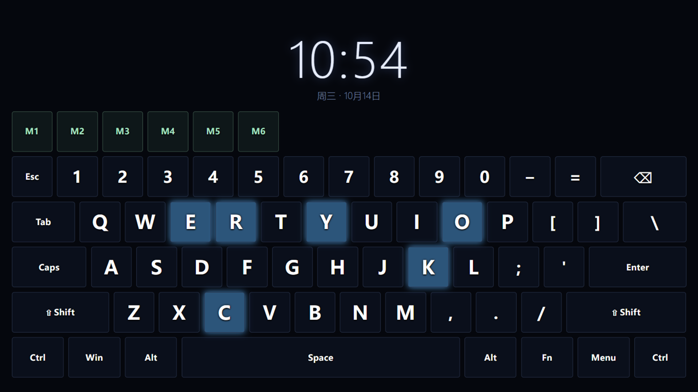
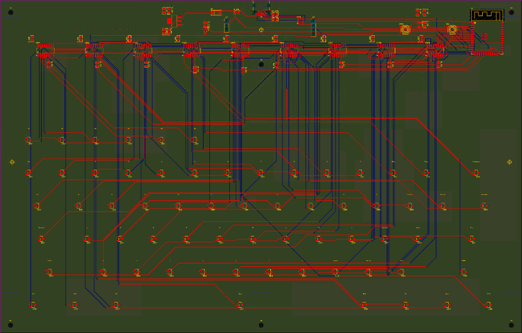
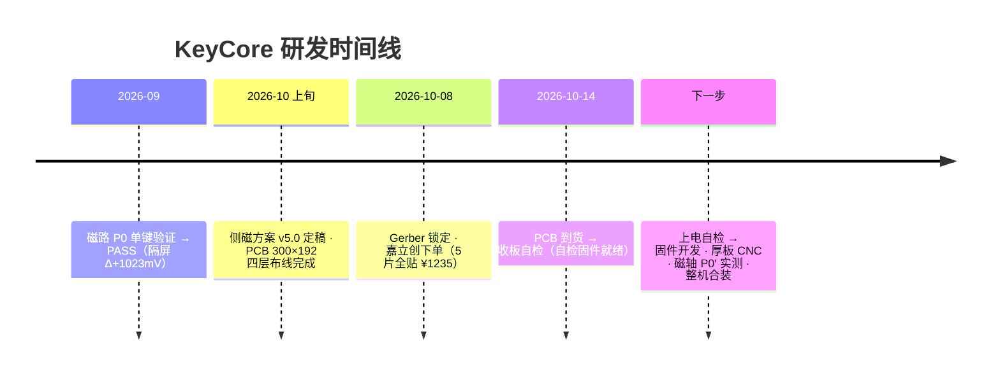

<div align="center">

# KeyCore · 磁轴透明屏幕键盘

**67 键磁悬浮轴体 · 13.3" 屏下显示 · 无机械轴 · 全开源**

`磁轴键盘` `Hall Effect` `ESP32-S3` `Transparent Keyboard` `Flux Keyboard 复刻` `嘉立创EDA`

[](#-项目状态)
[](#-项目状态)
[](#-许可)

*Finalmouse/Flux 式屏下键盘的国产开源复刻与再设计*



**屏下显示最终效果** —— 13.3" 屏幕实际显示画面：67 键位图 · 按键按下高亮 · 大时钟动效
（预览页 [keymap.html](04-显示层/keymap.html)，正式版为定制全屏程序）

<br clear="all" />

**PCB v43b-5c 封板版布线** —— 300×192mm 四层（L1 红 / L2 蓝 / GND+3V3 平面）：67 霍尔 · 9×74HC4051 · ESP32-S3 · DRC 全绿



</div>

---

## 📖 这是什么

一块 **300×192mm 的透明键盘**：PCB 上密布 67 颗霍尔传感器，键帽底部嵌磁铁，
按下时磁场变化被感应——**没有机械轴体，按压行程就是磁场行程**。
键盘上方悬浮一块 13.3" 1080P 屏幕（屏下键盘结构），显示内容完全可编程。

灵感来自 [Finalmouse x Wooting 的 Flux Keyboard](01-方案/竞品拆解-FluxKeyboard.md)，
本项目是其国产化开源复刻 + 再设计：磁路自主设计、电子自主绘制、结构参数化生成。

```
┌─────────────────────────────────────┐
│   13.3" 透明屏（显示：键位/宏/动画）  │ ← z 7.2+
│─────────────────────────────────────│
│   透明厚板 9mm（67 键孔打穿+磁道）    │ ← z 10.7+
│─────────────────────────────────────│
│   PCB 300×192 4层                    │
│   67×霍尔 + 9×多路开关 + ESP32-S3    │ ← z 0~1.6
│─────────────────────────────────────│
│   底壳（USB-C/背墙通道/12V）          │
└─────────────────────────────────────┘
   按压 → 键帽磁铁靠近霍尔 → ADC 采样 → 触发
```

## ✨ 核心特性

- **磁轴无接触**：HAL49ESO 霍尔 ×67，模拟量采样 → 触发力度/行程软件可调（类 Wooting 模拟轴）
- **9× 74HC4051 分时复用**：67 路模拟信号仅占 1 个 ADC 通道 + 12 个控制脚
- **4 层板电源架构**：内层整平面 GND/3V3 + 191 个缝合孔，67 颗霍尔供电零妥协
- **结构全参数化**：键位表 → OpenSCAD → 厚板 CNC 图纸 / 订购图，改键位即改结构件
- **屏下显示可编程**：定制全屏程序（非浏览器方案），显示键位图/宏状态/力度可视化

## 📊 关键参数

| 项 | 规格 |
|---|---|
| 配列 | 65% 标准配列 61 键 + 宏 M1~M6（共 67） |
| 主控 | ESP32-S3-WROOM-1-N4R8（4MB Flash + 8MB Octal PSRAM, WiFi+BLE） |
| 传感 | HAL49ESO 线性霍尔 ×67（SOT-23，1.9mm 间距采样） |
| 采样链 | 74HC4051 ×9（MUX_A/B/C 地址 + EN_1~9 使能）→ ESP32 ADC |
| PCB | 300.2 × 192 × 1.6mm，4 层（TOP/In1-GND/In2-3V3/BOT），JLC 有铅喷锡 |
| 结构 | 透明亚克力厚板 300.2×192×9mm，67 键孔打穿 + 73 条磁道（CNC） |
| 显示 | 13.3" IPS 1080P（300.2×187.4×2.5mm，HDMI 驱动板 / 计划 Orange Pi 直驱） |
| 接口 | USB-C（数据+5V）、UART 排针、DS18B20 温度探头座、12V 屏供电 |
| 触发 | 磁铁 4×2×2 N52 ×2/键 嵌键帽侧壁（磁路 v5.3，P0′ 实测待做） |

## 🗂 仓库结构

```
KeyCore/
├── 00-文档/          # 项目文档（v3.0 时代已标注存档）
├── 01-方案/          # 方案演进（Flux 竞品拆解、侧磁方案决策）
├── 02-结构图纸/      # ★ OpenSCAD 参数化结构（厚板 v4 / 底壳 / 键位表 CSV）
├── 03-固件/          # ESP32 固件工程（P0 验证完成，正式固件开发中）
├── 04-显示层/        # 屏幕显示页（键位图/坏点测试）
├── 06-测试记录/      # P0 磁路实测数据与报告
├── 07-PCB/           # ★ PCB 交付物（Gerber/打板清单/BOM/全程总结）
│   ├── footprints/   #   封装库
│   ├── tools/        #   处理脚本（历史 KiCad 管线，已退役）
│   └── output/       #   ★★ 所有交付文档都在这里
└── 99-归档/          # 历史方案存档
```

## 📍 项目状态



<details>
<summary><b>已完成里程碑</b>（点击展开）</summary>

- ✅ **P1 屏幕验收**：13.3" 屏 + 驱动板点亮，实测三围与显示区
- ✅ **P0 磁路验证**：隔屏检测可行、极性双向响应、邻域噪声 ±4mV（`06-测试记录/`）
- ✅ **BOM 闭环**：105 元件全部绑定立创 C 号，封装逐项对照商城实物核验
- ✅ **机械定稿**：PCB 300×192 = 厚板同宽 = 屏幕同宽三件套对齐；键位坐标 EDA 实测基准
- ✅ **布线**：FreeRouting 全局布线（GND/3V3 走内层平面 + 191 缝合孔），DRC 仅剩 1 项已接受项
- ✅ **下单**：订单 Y4，生产稿已确认，10-13 发货

</details>

## 🛠 技术栈与工具链

| 层 | 工具 |
|---|---|
| EDA | 嘉立创EDA专业版 4.1.60 + [easyeda-agent](https://github.com/zhoushoujianwork/easyeda-agent) CLI 自动化 |
| 布线 | FreeRouting 1.9.0（DSN 剔除电源网 → SES 回导） |
| 结构 | OpenSCAD（参数化：键位 CSV → 板/壳/订购图） |
| 固件 | PlatformIO + arduino-esp32 / ESP-IDF |
| 验证 | Gerber 机检脚本 · DRC 双口径（几何终审 + 引擎审计） |

## 📚 权威文档（新读者按此顺序读）

1. [画线总结-过程与经验](07-PCB/output/画线总结-过程与经验-20261008.md) —— 全流程 SOP + 18 条踩坑 + 费用实测
2. [设计说明-KeyCore总装](07-PCB/output/设计说明-KeyCore总装-20261007.md) —— 层叠/分区/引脚定稿
3. [打板清单](07-PCB/output/打板清单-KeyCore-v43b-3c-20261008.md) —— BOM 14 项 C 号 + 自留件 + 费用
4. [thickplate-v4.scad](02-结构图纸/thickplate-v4.scad) —— 厚板加工源（67 孔打穿版）

## 💰 成本实况

| 阶段 | 花费 |
|---|---|
| P0/P1 验证（屏+霍尔+磁铁样品） | ~¥470 |
| PCB 4 层 ×5 + SMT 全贴（本单） | ¥1235.19 |
| 厚板 CNC（待下） | 预估 ¥100~200 |
| **首台物料合计** | **~¥2000**（定型后单台 BOM ≈¥1250） |

## 🗺 Roadmap

- [x] P0 磁路验证 · P1 屏幕验收
- [x] PCB 布线 + 下单（v43b-3c）· 收板（10-14）
- [ ] **上电自检**（清单+固件就绪：[收板上电自检](06-测试记录/收板上电自检-20261014.md)）→ 固件（octal PSRAM / 霍尔扫描 / USB HID）
- [ ] 厚板 CNC 下单（图纸就绪：[厚板订购图 V6r](07-PCB/output/厚板订购图-V6-打穿版-20261007.svg)）
- [ ] 磁轴 P0′ 三项实测（回弹/串扰/隔屏Δ）→ 键帽块 P3 设计
- [ ] 屏幕方案落地（Orange Pi Zero 2W + 定制全屏程序）
- [ ] v2 候选：74HC4067 精简（9→5 颗）· ESP32-P4 直驱屏幕 · N16R8V 模组

## 🤝 说明

- 本项目为个人研发项目，过程文档全量保留（包括失败与返工），供同样想做磁轴键盘的玩家参考
- 复刻请重读 [画线总结](07-PCB/output/画线总结-过程与经验-20261008.md) 的"踩坑全集"——每一条都是真实返工换来的
- 嘉立创按图生产不纠错：**DFM 放行 ≠ 设计正确**，正确性唯一来源是数据手册比对与实测

---

<div align="center">

*键盘的尽头是磁场 · Magnetic or nothing*

</div>
